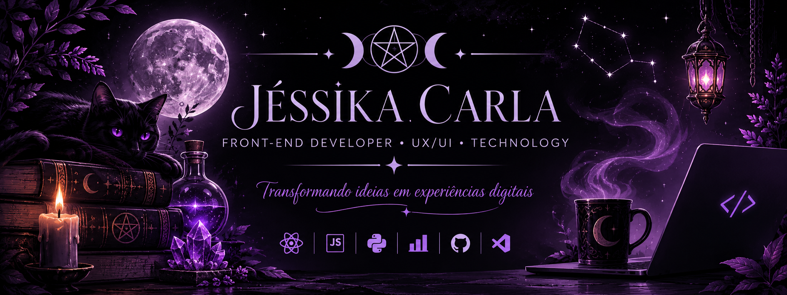

  

<h1 align="center">☾ Jéssika Carla | Tech</h1>

  <strong>Desenvolvedora Front-End em formação</strong> 
  Entre códigos, criatividade e um toque de magia digital.

  
  
  
  
  

---

## ✦ Sobre mim

Olá! Sou Jéssika Carla, desenvolvedora em formação, apaixonada por tecnologia, interfaces e resolução de problemas.

Atualmente, estou aprofundando meus conhecimentos em **desenvolvimento Front-End**, com foco em React, enquanto também exploro Python, Inteligência Artificial e Análise de Dados.

Gosto de unir lógica e criatividade para transformar ideias em experiências digitais. Meu objetivo é evoluir continuamente, construir projetos relevantes e crescer profissionalmente na área de tecnologia.

## ☽ Minha caixa de ferramentas

| Área | Tecnologias e ferramentas |
|---|---|
| **Front-End** | HTML5 · CSS3 · JavaScript · React |
| **Estilização** | Bootstrap · Tailwind CSS |
| **Dados e IA** | Python · Pandas · Matplotlib · Streamlit · RAG e LLMs |
| **Design e desenvolvimento** | Figma · VS Code |
| **Versionamento** | Git · GitHub |

## ✧ Projetos em destaque

| Projeto | Sobre |
|---|---|
| [Lanmovies](https://github.com/jessy-carla/lanmovies) | Aplicação de filmes desenvolvida com React e integração com a API TMDB. |
| [Análise de Pessoas Desaparecidas](https://github.com/jessy-carla/dataset-pessoas-desaparecidas) | Projeto de análise de dados utilizando Python e Pandas. |
| [Portfólio](https://jessy-carla.github.io/portfolio-jessika/) | Meu espaço para apresentar projetos e experiências em desenvolvimento web. |
| [Sistema Lumen](https://github.com/jessy-carla/Sistema-Lumen) | Repositório de projeto de desenvolvimento. |

## 🔮 No meu grimório de estudos

- Desenvolvimento Front-End com React.
- Construção de interfaces e experiência do usuário (UX/UI).
- Python e análise de dados.
- Inteligência Artificial e aplicações com RAG.

## ☾ GitHub em números

  
  

## ✦ Vamos nos conectar?

  
  
  

---

  ☾ Construindo meu próprio universo, uma linha de código por vez. 
  <strong>“A magia acontece quando criatividade e tecnologia se encontram.”</strong> ✨

